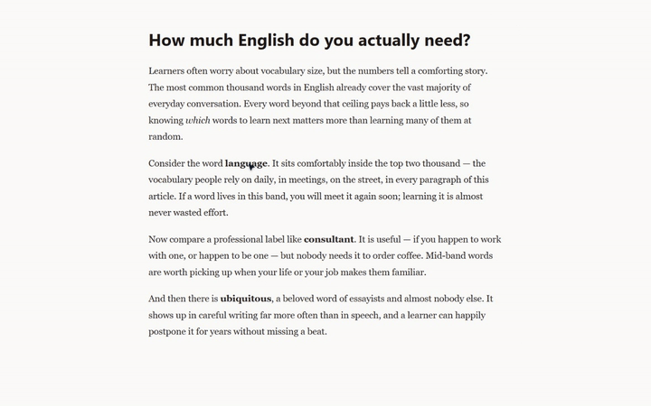
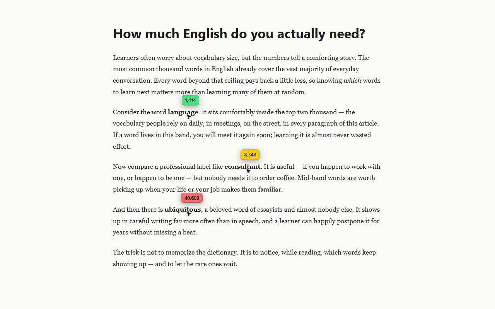

# Word Rank Hover

A browser extension that shows the **frequency rank** of any English word on a
page: point the mouse at a word and a small tooltip appears with its rank
(`1` = most common). Words outside the list show `>50k`.





**Repo:** <https://github.com/chealex-ya/word-rank-hover>

- Chrome / Edge / Brave (Chromium, Manifest V3) on **Windows, macOS, and Linux** —
  the extension is pure web code with nothing platform-specific.
- 100% offline — the word list is packaged inside the extension. No network
  calls, no tracking.
- List: [OpenSubtitles 2018](https://github.com/hermitdave/FrequencyWords)
  top 50,000 English words (film/TV subtitles — everyday spoken English).

## Install

From the store once published (links to follow), or from source / a downloaded
zip:

1. Open `chrome://extensions` (Edge: `edge://extensions`, Brave: `brave://extensions`).
2. Turn on **Developer mode** (top-right toggle).
3. Click **Load unpacked** and select the extension folder.
4. Open any page with English text and hover a word.

To use on local `file://` pages, enable **Allow access to file URLs** on the
extension's details page.

## Usage

| Action | Result |
| --- | --- |
| Hover a word (~150 ms) | Tooltip chip with the rank, e.g. `14,207` |
| `Alt+Shift+W` | Toggle the extension on/off |
| Click the toolbar icon | Settings popup |

The chip is filled with a traffic-light color (the number stays black):

| Fill | Rank | Meaning |
| --- | --- | --- |
| 🟢 Green | 1 – 5,000 | Go and learn — needed on a daily basis |
| 🟡 Yellow | 5,001 – 10,000 | You might need it, but it's not obligatory |
| 🔴 Red | 10,000+ (incl. `>50k`) | Don't go — the word is rarely in use |

Settings (toolbar icon):

- **Enabled** — master on/off (same as `Alt+Shift+W`).
- **Show rank** — on every hover, or only while `Alt` is held (less noise).
- **Hide the N most common words** — e.g. `1000` stops tooltips on "the",
  "and", etc. Default `0` shows everything.

## How it works

- `content.js` tracks the mouse and uses `document.caretRangeFromPoint()` to
  find the word under the cursor. The tooltip is a single fixed-position div
  with `pointer-events: none` — pages are not modified and clicks are not
  intercepted.
- `data/en_ranks.txt` — one `word rank` pair per line, rank 1 = most
  frequent. Parsed once per tab into a `Map` (~47k entries). In this corpus
  the top words are `you` (#1), `i` (#2), `the` (#3) — spoken English.
  Contractions are stored without the apostrophe ("don't" → `don`), so the
  lookup also tries apostrophe-free and prefix variants.
- Settings live in `chrome.storage.sync`. The service worker only manages the
  toolbar badge and the toggle keyboard shortcut.
- `data/en_ranks.txt` is listed in `web_accessible_resources` — required in
  MV3 for content scripts to be allowed to fetch a packaged file (the list is
  public data, nothing sensitive).

## Swapping in a different dictionary

Any plain-text list works. If it uses the hermitdave `word count` format
(sorted by descending count), rebuild with:

```powershell
powershell -File tools\rebuild-data.ps1 -Source C:\path\to\list.txt
```

If your list is already ranked, just replace `data/en_ranks.txt` with lines of
`word rank` and reload the extension. Keep it under ~100k lines — the whole
file is parsed once per tab.

## Known limitations

- Top frame only — words inside cross-origin iframes (embedded tweets, some
  comment widgets) are not covered.
- Canvas-rendered text (e.g. Google Docs) has no text nodes → no tooltip.
- Hyphenated compounds are looked up per part ("well-known" → "well" /
  "known").
- Non-Latin scripts (Russian etc.) are ignored — English ranks only.

## Future ideas

Firefox port, CEFR-level estimate (A1–C2 from rank), "save word" vocabulary
export, Chrome Web Store packaging.

## License

- **Code:** MIT — see [LICENSE](LICENSE).
- **Word list** (`data/en_ranks.txt`): derived from
  [FrequencyWords](https://github.com/hermitdave/FrequencyWords)
  (OpenSubtitles 2018 corpus) under
  [CC BY-SA 4.0](https://creativecommons.org/licenses/by-sa/4.0/) — details in
  [DATA_LICENSE.md](DATA_LICENSE.md).
